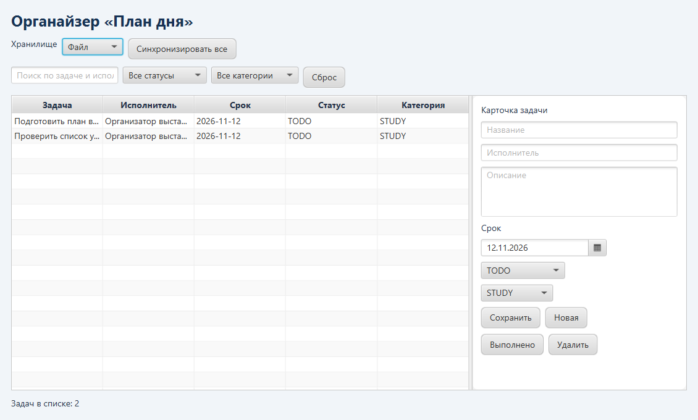

# Лабораторная работа № 3. «План дня»

Органайзер задач с поиском, фильтрами и синхронизацией. В интерфейсе можно переключаться между коллекцией в памяти, локальным файлом и встроенной реляционной БД H2. Цель работы — отделить логику органайзера от хранения с помощью **DAO** и **абстрактной фабрики**.



## Запуск

Из папки `lab3` выполните `mvn javafx:run`. Из общей папки в Windows выполните `.\labs.cmd 3`. Нужны JDK 21+ и Maven. H2 запускается внутри приложения.

## Как проверить синхронизацию

1. Выберите **Файл**, нажмите **Новая**, заполните карточку и нажмите **Сохранить**. Доступны название, описание, исполнитель, срок, категория и состояние.
2. Нажмите **Синхронизировать все** и переключитесь на **База H2**. Задача появится в БД с тем же идентификатором.
3. Измените задачу в H2 и снова синхронизируйте. Свежая версия появится и в файле, и в памяти.
4. Удалите задачу в одном источнике и синхронизируйте. Она исчезнет из списков остальных источников. В данных сохраняется отметка удаления, чтобы старая копия не вернулась при следующей синхронизации.

Записи сопоставляются по UUID. Побеждает версия с более свежим временем изменения. При равном времени удалённая запись имеет приоритет, а при равных признаках берётся версия из первого источника в порядке обхода. Синхронизация записывает результат в каждый источник последовательно.

## Структура кода и данные

| Элемент | Назначение |
| --- | --- |
| `Task` | Модель задачи с метаданными для синхронизации. |
| `TaskDao` | Единый контракт чтения и записи. |
| `MemoryDao`, `FileDao`, `JdbcDao` | Реализации для коллекции, Properties и H2 через JDBC. |
| `StoreFactory` | Общий контракт фабрик. Каждая фабрика создаёт согласованные DAO и описание источника. |
| `Organizer` | Операции с задачами, фильтрация и объединение версий. |
| `Main` | Экран JavaFX, переключение источников и настройки. |

| Настройка | По умолчанию | Назначение |
| --- | --- | --- |
| `datasource` | `file` | Начальный источник. Допустимы `memory`, `file`, `database`. |
| `file.path` | `data/tasks.properties` | Файл задач. |
| `database.path` | `data/organizer` | Базовое имя файла H2. |
| `logs.path` | `logs` | Каталог журнала. |

Настройки из `src/main/resources/application.properties` можно переопределить в `config.local.properties` в рабочей папке приложения. Относительные пути считаются от этой папки. Данные в памяти пропадают после выхода.

### Как взаимодействуют DAO и фабрика

```text
Main → Organizer → TaskDao → MemoryDao / FileDao / JdbcDao
StoreFactory → TaskDao + StoreInfo
```

При выборе хранилища `Main` передаёт соответствующий `TaskDao` сервису `Organizer`. Сервис вызывает одни и те же операции чтения и записи во всех случаях. Фабрика создаёт пару из DAO и описания источника `StoreInfo`. Интерфейс использует это описание для списка хранилищ.

| Источник | Где лежат задачи |
| --- | --- |
| Память | Коллекция объектов `Task`, ключом служит UUID. |
| Файл | `data/tasks.properties`. При записи файл заменяется подготовленной версией. |
| База H2 | `data/organizer.mv.db`. Данные лежат в таблице `tasks` с первичным ключом `id`. Операция `MERGE` через JDBC вставляет новую строку или обновляет существующую. |

### Настройки и журнал

Настройки из таблицы выше можно записать в `config.local.properties`. Например, строка `datasource=database` открывает органайзер сразу с выбранной БД. Журнал `logs/organizer-0.log` фиксирует создание, изменения, удаления и синхронизацию. При заполнении текущего файла журнал переключается на следующий.

## Тестирование

В каталоге `lab3` выполните `mvn test`. [OrganizerTest.java](src/test/java/ru/semenyutin/lab3/OrganizerTest.java) через Mockito проверяет валидацию и делегирование DAO. Отдельный тест прогоняет создание, обновление и удаление задачи через память, временный файл и временную H2.

## Технологии

- **Java 21 и JavaFX** — модель задачи и интерфейс органайзера.
- **JDBC и H2** — встроенное реляционное хранилище.
- **Java Util Logging** — журнал операций.
- **Maven, JUnit 5 и Mockito** — сборка и тестирование.

## Структура проекта

| Файл | Назначение |
| --- | --- |
| [Task.java](src/main/java/ru/semenyutin/lab3/Task.java) | Модель задачи и метаданные синхронизации. |
| [TaskDao.java](src/main/java/ru/semenyutin/lab3/TaskDao.java) | Общий интерфейс хранения. |
| [StoreFactory.java](src/main/java/ru/semenyutin/lab3/StoreFactory.java) | Фабрики и три реализации DAO. |
| [Organizer.java](src/main/java/ru/semenyutin/lab3/Organizer.java) | Поиск, операции с задачами и синхронизация. |
| [application.properties](src/main/resources/application.properties) | Хранилище по умолчанию и пути к данным и журналу. |
